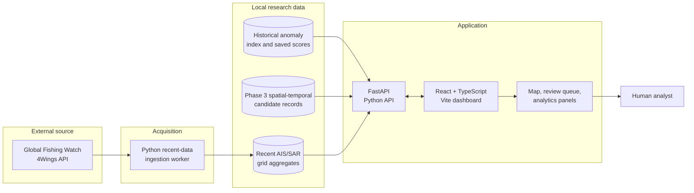

<div align="center">

# 🌊 DARK-FLEET

### Maritime Activity Analysis & Anomaly Intelligence

**Connecting AIS reports, satellite SAR observations and behavioural context — so analysts can investigate what deserves attention.**

<p>
  <a href="https://github.com/Vedant2004X/DARK-FLEET"></a>
  
  
  
  
</p>

[Overview](#-the-problem) · [Architecture](#-how-it-works) · [Capabilities](#-inside-the-platform) · [Data](#-research-data-snapshot) · [Run locally](#-run-locally) · [Research](#-research-direction)

</div>

---

> **Project status — November 2026**  
> The local React + FastAPI application is integrated, the v0.9 read-only analytics workspace is connected, and the frontend production build has passed. The source code is on GitHub. **The project is not yet hosted as a public live application, and a validated multimodal fusion model is not claimed in this release.**

## 🧭 The problem

Maritime monitoring rarely has one perfect source of truth.

- **AIS (Automatic Identification System)** provides vessel-reported identity and navigation information, but it is cooperative. Messages can be missing, delayed, noisy or affected by reception coverage and data quality.
- **SAR (Synthetic Aperture Radar)** provides an independent radar observation of physical targets. It does not automatically provide the identity or behavioural history of a vessel.

The hard problem is not simply putting two datasets on a map. It is interpreting observations that differ in time, location, resolution and reliability — without turning uncertainty into an accusation.

**DARK-FLEET is designed as a human-in-the-loop maritime research platform.** It organises AIS-derived activity, SAR observation records and anomaly-related context into a dashboard that helps an analyst review unusual or unmatched activity.

## 🎯 What the platform is designed to do

<table>
  <tr>
    <td width="50%">
      <h3>01 · Historical anomaly intelligence</h3>
      Explore the existing historical anomaly index, review saved anomaly scores, filter observations by date and inspect records in context.
    </td>
    <td width="50%">
      <h3>02 · SAR / AIS candidate review</h3>
      Inspect stored spatial-temporal proximity candidates and association summaries. Candidates remain hypotheses until independently validated.
    </td>
  </tr>
  <tr>
    <td width="50%">
      <h3>03 · Recent grid activity</h3>
      View recent AIS/SAR activity aggregated by grid cell, flag and hour across configured regions. This view is intentionally not presented as vessel-level tracking.
    </td>
    <td width="50%">
      <h3>04 · v0.9 Model Intelligence</h3>
      Review historical summaries, prioritised records and contextual feature deviations, while preserving the original saved anomaly outputs.
    </td>
  </tr>
</table>

## 🏗️ How it works

The application separates data acquisition, stored research outputs, API services and the analyst interface. Historical analysis data and recent grid ingestion are related parts of the project, but they are **different data products with different time ranges and granularity**.



### Request lifecycle

1. An analyst selects a date range, opens a review queue or selects an observation.
2. The React application sends an HTTP request to a FastAPI endpoint.
3. The backend validates the request and queries the relevant indexed research data.
4. The API returns structured JSON; the frontend updates the appropriate summary, table, map or explanation panel.
5. The analyst interprets the evidence and uncertainty. The platform does not make an automated legal determination.

## 🖥️ Inside the platform

| Workspace | What it provides | Interpretation rule |
|---|---|---|
| Historical overview | Date-filtered counts and summaries from the saved historical anomaly index | A saved anomaly score is not a confirmed incident label |
| Observation review | Filtered / paginated observations and selected-record details | A map sample is not a reconstructed vessel track |
| SAR/AIS comparison | Stored comparisons and Phase 3 proximity candidates | Candidate proximity is not proof of vessel identity |
| Recent grid activity | Aggregated AIS/SAR activity across grid cells, flags and hours | Grid aggregates do not expose individual vessel identity |
| Model Intelligence (v0.9) | Review queue, status, association overview and feature-deviation context | The analytics module reuses saved scores; it does not retrain the model |

### v0.9 explanation method

The explanation workspace uses **z-score-style feature deviations** against a reference population. Where a vessel-type cohort has at least 30 observations, that cohort can be used as the baseline; otherwise the calculation falls back to a broader global baseline.

This helps answer: *“Which features look unusual relative to this reference group?”*  It does **not** establish causality, calculate SHAP values or reconstruct the original Isolation Forest decision path.

## 📊 Research data snapshot

The following figures are from the recorded v0.9 local status response. They describe different datasets and must not be added together or interpreted as counts of unique vessels or confirmed incidents.

| Data product | Recorded size | Time / coverage | What it means |
|---|---:|---|---|
| Historical anomaly index | **2,326,571 rows** | 01–05 Jan 2022 | Existing historical anomaly outputs and saved scores |
| Phase 3 candidate store | **193,747 candidate rows** | Stored candidate dataset | Proximity / association candidates, not confirmed matches |
| SAR records with candidates | **3,151 records** | Stored candidate dataset | SAR records for which candidate rows are available |
| Recent AIS grid activity | **1,329,717 rows** | 26–28 Oct 2026 · 10 regions | Aggregated grid activity; no individual identity |
| Recent SAR grid activity | **1,682 rows** | 26–28 Oct 2026 · 10 regions | Aggregated grid activity; identity unavailable |

**Recent-grid record granularity:** `GRID_CELL_FLAG_HOUR`  
**Identity availability:** `false`

> The figures are local working-record snapshots, not independently audited performance results. Historical vessel-level observations, Phase 3 candidate rows and recent grid aggregates have different semantics. Do not describe them all as vessel tracks.

## 🧠 Analytics approach

### Existing anomaly outputs

The historical index contains existing anomaly outputs associated with an Isolation Forest workflow. Isolation Forest is an unsupervised method that isolates observations through random feature splits; unusually isolated points tend to have shorter average path lengths. The v0.9 workspace **reuses saved scores** for analysis and review. It does not claim a new training run.

### Candidate generation is not association validation

Spatial-temporal screening narrows the set of AIS observations that could correspond to a SAR observation. A candidate is a possible relationship, not a confirmed match. Candidate multiplicity, coordinate resolution, time tolerance and reference labels all matter when validating an association method.

### Research question

> Can an explainable, behaviour-aware combination of AIS history, SAR evidence and data-integrity context improve the prioritisation of anomalous or unmatched maritime activity — particularly when AIS is sparse or missing — compared with AIS-only and association-only baselines?

## 🧰 Technology stack

| Layer | Technology | Role in DARK-FLEET |
|---|---|---|
| Language / processing | Python | Data ingestion, backend logic and analytics |
| API server | FastAPI + Uvicorn | HTTP endpoints between research data and browser |
| Validation | Pydantic | Typed request / response validation in the API layer |
| Data storage | SQLite + processed files | Local indexed research datasets and analytical outputs |
| Data provider | Global Fishing Watch 4Wings API | AIS vessel-presence and SAR report inputs |
| Frontend | React + TypeScript | Component-based dashboard and typed API integration |
| Build tooling | Vite + npm | Frontend development server and production build |
| Mapping | Leaflet-based components | Geographic display of observation and activity layers |
| Version control | Git + GitHub | Source history and collaboration |

## 🚀 Run locally

### Requirements

- Python 3.11 / 3.12
- Node.js and npm
- Git
- The separate processed research datasets described in [Data files are not in Git](#-data-files-are-not-in-git)

### 1. Clone the source

```powershell
git clone https://github.com/Vedant2004X/DARK-FLEET.git
cd DARK-FLEET
```

### 2. Install backend dependencies

Run from the repository root:

```powershell
py -3 -m venv backend\.venv
backend\.venv\Scripts\python.exe -m pip install --upgrade pip
backend\.venv\Scripts\python.exe -m pip install -r backend\requirements.txt
```

Start the API in a separate terminal:

```powershell
Push-Location .\backend
.\.venv\Scripts\python.exe -m uvicorn app.main:app --host 127.0.0.1 --port 8000
```

Backend endpoints:

- Health: <http://127.0.0.1:8000/api/health>
- Interactive API docs: <http://127.0.0.1:8000/docs>
- v0.9 status: <http://127.0.0.1:8000/api/v09/status>

### 3. Install and start the frontend

Open another terminal at the repository root:

```powershell
Push-Location .\frontend
npm.cmd install
npm.cmd run dev -- --host 127.0.0.1 --port 5175
```

Open <http://127.0.0.1:5175/>.

> On Windows PowerShell, `npm.cmd` avoids the PowerShell script execution-policy issue that can block `npm.ps1`.

### 4. Production build

From `frontend/`:

```powershell
npm.cmd run build
```

The recorded local build after the laptop restart passed TypeScript compilation and Vite bundling (1,628 modules transformed). A successful frontend build does not, by itself, prove that the backend or production hosting is available.

### 5. Optional recent-data update

The ingestion worker is separate from the dashboard. To fetch new recent GFW reports, provide `GFW_API_ACCESS_TOKEN` through a secure environment-variable or secret-manager configuration, then use the worker's **recent** mode. Do not commit the token, print it in logs or put it in this README. Historical backfill is not the normal recent-update workflow.

## 🗃️ Data files are not in Git

Large processed datasets under `backend/data/` are intentionally excluded from this repository. A fresh clone contains **application source and documentation**, not the local SQLite research databases. The historical overview, Phase 3 candidate panels and recent-grid panels require their corresponding data artifacts to be supplied separately.

Keep the research data backed up separately. For a later hosted deployment, transfer only the required data files to persistent storage and verify their versions, provenance and expected paths before starting the API.

## 🔌 API surface

| Endpoint | Purpose |
|---|---|
| `/api/health` | Runtime / service health |
| `/api/model-summary` | Historical summary for a selected window |
| `/api/anomalies` | Filtered and paginated historical observations |
| `/api/map-observations` | Map-oriented observation sample |
| `/api/map-sar-detections` | SAR map records and association context |
| `/api/sar-ais-matches` | Saved comparison / candidate information |
| `/api/data-range` | Available range in the current dataset |
| `/api/v09/status` | v0.9 analytics readiness and data-status summary |
| `/api/v09/explain/{id}` | Contextual feature-deviation explanation |
| `/api/v09/association-overview` | Candidate-association summary |

Health means the service responds; it does not certify the quality of an anomaly model or an association.

## 🔬 Research direction and base paper

The selected base paper is:

**Rodger, M. & Guida, R. (2021). “Classification-Aided SAR and AIS Data Fusion for Space-Based Maritime Surveillance.” _Remote Sensing_, 13(1), 104.**  
[https://doi.org/10.3390/rs13010104](https://doi.org/10.3390/rs13010104)

The paper provides a foundation for SAR-to-AIS association. DARK-FLEET's proposed extension is to move beyond matching alone by studying behaviour history, data-integrity context and explainable anomaly prioritisation under incomplete AIS. SAR/AIS association and dark-vessel monitoring are established research areas; the contribution must be framed as a specific research question and validated experimentally, not as the invention of dark-vessel detection.

## 🛡️ Responsible interpretation

- An AIS gap is not proof of suspicious or illegal activity.
- An unmatched SAR observation is not automatically a dark vessel.
- A proximity candidate is not a confirmed vessel identity.
- An unsupervised anomaly score is not a ground-truth incident label.
- Feature deviations are contextual indicators, not SHAP values or causal explanations.
- Recent grid aggregates do not provide individual vessel identity or continuous tracks.
- No independently validated accuracy, precision, recall, F1 or illegal-vessel detection rate is claimed for the current multimodal research direction.
- DARK-FLEET is an academic research prototype, not a certified operational maritime-surveillance service.

## 🗺️ Roadmap

- [x] Integrate the local FastAPI backend and React / TypeScript dashboard.
- [x] Integrate historical anomaly review and map-oriented exploration.
- [x] Add SAR/AIS comparison and candidate-review panels.
- [x] Add recent grid ingestion and activity views.
- [x] Add the v0.9 read-only analytics workspace.
- [x] Exclude large databases, secrets and local build artifacts from Git.
- [ ] Audit Phase 3 inputs, candidate multiplicity and reference associations.
- [ ] Establish independently verified labels and baseline comparisons.
- [ ] Evaluate precision, recall, F1 and false-positive behaviour under controlled missing-AIS tests.
- [ ] Complete persistent hosting, HTTPS, secret management, monitoring and backups.

---

<div align="center">

**Built as an academic research project by Vedant Sankpal**  
[GitHub: @Vedant2004X](https://github.com/Vedant2004X) · [DARK-FLEET repository](https://github.com/Vedant2004X/DARK-FLEET)

*Maritime activity analysis · Explainable review · Human-in-the-loop intelligence*

</div>
